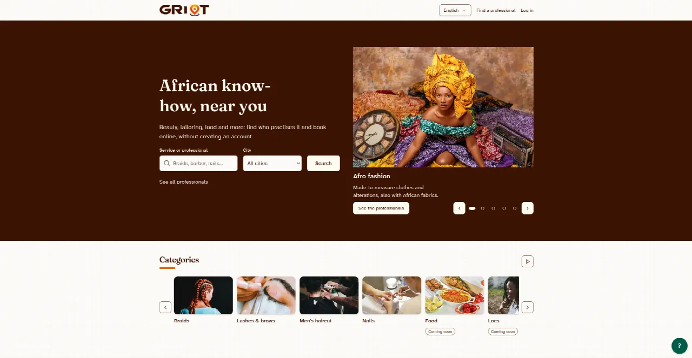

# Griot

Una web app per trovare e prenotare i professionisti del savoir-faire africano: bellezza, moda, cucina.



## Cos'è e per chi

Griot mette in contatto chi cerca un servizio (taglio, treccine, locs, unghie, make-up, ciglia e sopracciglia, moda afro, cucina) con i professionisti che lo offrono.

- **Chi prenota non ha un account**: sceglie un servizio e un orario libero, lascia nome e contatto e riceve un link privato alla sua prenotazione.
- **Nessun pagamento online**: Griot serve a trovare e prenotare, il resto si regola con il professionista.
- **I professionisti hanno un'area privata**, dietro accesso. La registrazione è chiusa: gli account li crea il gestore del sito.

Il progetto è **in sviluppo**, online in una fase privata con pochi professionisti di prova.

## Cosa fa oggi

- Home con ricerca per servizio e città, categorie, professionisti in evidenza e « Come funziona ».
- Lista dei professionisti con ricerca, filtri e ordinamento; pagina pubblica di ogni professionista, con servizi, opzioni e foto del lavoro.
- Prenotazione pubblica sugli orari liberi, calcolati dalle fasce settimanali e dalle durate dei servizi, senza sovrapposizioni. Il cliente può annullare dal suo link privato.
- Area del professionista: vetrina (con anteprima e pubblicazione), foto del profilo e galleria, servizi e opzioni, fasce orarie, prenotazioni da confermare, rifiutare o annullare, e prenotazioni aggiunte a mano.
- Email per le prenotazioni (nuova richiesta, cambio di stato, annullamento, promemoria delle richieste in attesa).
- Dati dei clienti resi anonimi sei mesi dopo l'appuntamento.
- Interfaccia in italiano, francese e inglese; informativa sulla privacy e termini d'uso, ancora in bozza.

## Stack

Versioni da `composer.json` e `package.json`:

- PHP `^8.4`, Laravel 13 (`^13.17`), Laravel Fortify per l'accesso
- Inertia.js 3 (`inertiajs/inertia-laravel` `^3.0`, `@inertiajs/react` `^3.0.0`), React `^19.2.0`, TypeScript `^5.7.2`
- Tailwind CSS `^4.0.0`, componenti basati su Radix; Vite `^8.0.0` con `vite-plus` `0.3.0` (comando `vp`)
- Test con Pest `^5.3`, stile con Pint `^1.27`, analisi statica con Larastan `^3.9`
- Database: PostgreSQL in produzione e nella CI; MySQL in sviluppo e SQLite in memoria nei test locali
- Produzione su Render con un'immagine Docker (`Dockerfile`, `render.yaml`); foto su un archivio compatibile S3

## Avvio in locale

Servono PHP 8.4 con le estensioni `gd` ed `exif`, Composer, Node (22, come la CI) e un database MySQL vuoto.

```bash
composer setup
```

Installa le dipendenze, crea `.env` da `.env.example`, genera la chiave, lancia le migrazioni e costruisce il frontend. Prima delle migrazioni, in `.env` vanno messi i dati del proprio database (`DB_DATABASE`, `DB_USERNAME`, `DB_PASSWORD`): quelli di `.env.example` sono esempi. In locale le email finiscono nel log (`MAIL_MAILER=log`) e le foto nella cartella `storage` (`MEDIA_DISK_DRIVER=local`).

```bash
php artisan db:seed      # categorie e dati di prova, solo in sviluppo
composer dev             # server, coda, log e Vite insieme
```

Un professionista si crea da riga di comando (stampa una password iniziale una sola volta):

```bash
php artisan provider:create "Nome della vetrina" persona@example.test Città
```

## Qualità

| Cosa                                          | Comando               |
| --------------------------------------------- | --------------------- |
| Tutto, prima di ogni Pull Request             | `composer ci:check`   |
| Test PHP (con Pint in sola lettura e PHPStan) | `composer test`       |
| Correggere lo stile PHP                       | `composer lint`       |
| Frontend: formattazione e lint                | `npm run check`       |
| Frontend: correggere                          | `npm run check:fix`   |
| Tipi TypeScript                               | `npm run types:check` |

I test e `composer ci:check` vanno lanciati con `composer dev` spento. Su GitHub girano cinque controlli a ogni Pull Request ([docs/ci.md](docs/ci.md)). Le regole di accessibilità (bersagli di tocco, focus visibile, contrasto, movimento ridotto) sono in [docs/accessibility.md](docs/accessibility.md).

## Documentazione

| File                                                    | Di cosa parla                                                     |
| ------------------------------------------------------- | ----------------------------------------------------------------- |
| [accessibility.md](docs/accessibility.md)               | regole di accessibilità e movimento                               |
| [bookings.md](docs/bookings.md)                         | prenotazioni: stati, orari liberi, email, area del professionista |
| [brand.md](docs/brand.md)                               | logo provvisorio e colori                                         |
| [ci.md](docs/ci.md)                                     | i controlli automatici su GitHub                                  |
| [deploy.md](docs/deploy.md)                             | deploy su Render, passo per passo, con backup e ripristino        |
| [gallery.md](docs/gallery.md)                           | la galleria delle foto del lavoro                                 |
| [home.md](docs/home.md)                                 | la home page                                                      |
| [legal.md](docs/legal.md)                               | bozze di informativa e termini d'uso                              |
| [link-previews.md](docs/link-previews.md)               | l'anteprima dei link condivisi                                    |
| [media-storage.md](docs/media-storage.md)               | dove stanno le immagini                                           |
| [photos.md](docs/photos.md)                             | le foto del sito, le fonti e lo script che le prepara             |
| [production.md](docs/production.md)                     | la checklist di produzione                                        |
| [provider-first-steps.md](docs/provider-first-steps.md) | guida per i professionisti: i primi passi prima di pubblicare     |
| [provider-link.md](docs/provider-link.md)               | guida per i professionisti: il link e il QR code                  |
| [providers-list.md](docs/providers-list.md)             | la lista e la pagina dei professionisti                           |
| [roadmap.md](docs/roadmap.md)                           | sprint, cose fatte e da fare                                      |
| [search.md](docs/search.md)                             | la ricerca nella lista                                            |
| [translations.md](docs/translations.md)                 | testi e lingue                                                    |

Lo schema del database è in `docs/griot-schema.png` (con i sorgenti `.sql` e `.mwb`).

## Stato e prossimi passi

Cosa è fatto, cosa manca prima del lancio pubblico e cosa viene dopo: [docs/roadmap.md](docs/roadmap.md).

## Licenza

Nessun file di licenza per ora: le condizioni d'uso del codice sono ancora da decidere.
